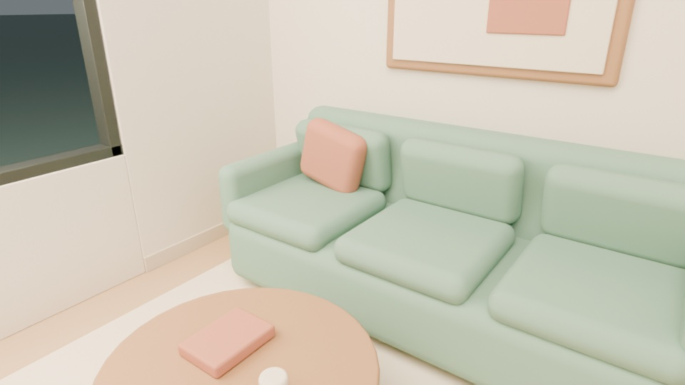

# 户型漫游

[运行示例](#运行示例)　·　[制作流程](制作流程.md)　·　[导览图卡](#制作导览图卡)　·　[参考与许可](#参考与许可)

用 Blender 把户型平面图做成全屋漫游。用俯瞰镜头交代格局，降到入户门前，等墙体升起、门打开后，再沿实际通路走进各个空间。导览文字使用简体中文。

| 全屋俯瞰 | 走进客厅 |
| --- | --- |
|  |  |

这里收录了[中文制作流程](制作流程.md)、一个可运行的虚构户型示例，以及将导览文案生成透明图卡的工具。制作新户型时，先按图确认尺寸、门窗与通路，再为这套房搭模型和安排镜头。示例脚本用代码描述尺寸，不会自动识别户型图片。

## 运行示例

从仓库根目录运行。把 `blender` 换成你电脑上的 Blender 可执行文件路径即可。macOS 应用的默认路径是 `/Applications/Blender.app/Contents/MacOS/Blender`。

```bash
blender -b --factory-startup --python-exit-code 1 --python scripts/build_demo.py -- --output build/demo.blend
```

打开 `build/demo.blend`，在相机视图拖动时间轴。示例约十三秒，每秒二十四帧，已用 Blender 5.3 验证。可用时间轴的中文标记找到全屋俯瞰、墙体升起、开门、经过玄关和抵达客厅的位置。示例用基础几何搭建并自带材质和灯光，适合练习运镜。它的渲染输出为逐帧图片。

```bash
blender -b build/demo.blend -a
```

## 制作导览图卡

用 Python 安装依赖，准备一款本机可用的简体中文字体，再运行下面的命令。把字体路径替换为实际文件。

```bash
python3 -m venv .venv
source .venv/bin/activate
python -m pip install -r requirements.txt
python scripts/make_cards.py --cues examples/cues.json --output build/cards \
  --font /path/to/SimplifiedChinese.otf --resolution 960 540
```

`examples/cues.json` 记录每张图卡的起止秒数、标题和正文。透明图片按同一顺序编号。剪辑时把渲染画面放入底层，按表中的时间放置图卡，再加入配乐和导出视频。更换新户型时，要按实际入画时间重写导览。

## 参考与许可

全屋漫游的表现方式参考了[原项目](https://github.com/ownding/larktun-monitor)及其[演示视频](https://www.bilibili.com/video/BV1Zje564Ebk)。本仓库的示例户型与示例渲染为独立制作。仓库中的代码和文档采用 [MIT 许可](LICENSE)。第三方字体需自行取得，并遵守其许可。
