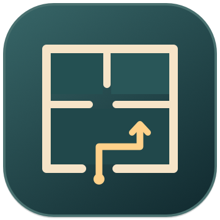
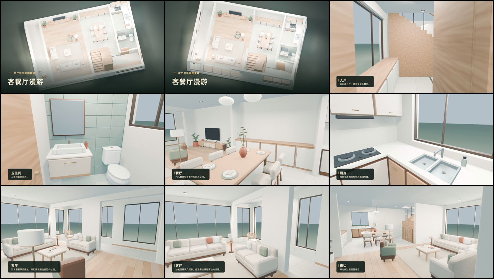
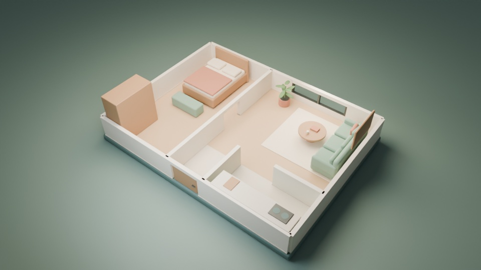

<p align="center">
  
</p>

<h1 align="center">户型漫游</h1>

<p align="center"><strong>把户型平面图做成全屋漫游视频</strong></p>

<p align="center">
  <a href="#运行示例"></a>
  <a href="#制作导览图卡"></a>
  <a href="LICENSE"></a>
</p>

<p align="center">
  <strong>
    <a href="#项目介绍">项目介绍</a> · <a href="#漫游预览">漫游预览</a> · <a href="docs/技能使用教程.md">使用教程</a>
    <br>
    <a href="#智能体技能">智能体技能</a> · <a href="制作流程.md">制作流程</a> · <a href="#制作导览图卡">导览图卡</a> · <a href="#参考与许可">参考与许可</a>
  </strong>
</p>

> 从全屋俯瞰降到入户门，等墙体升起、门打开，再沿实际通路走进各个空间。全程使用简体中文导览。

## 项目介绍

用 Blender 把户型平面图做成全屋漫游。本仓库将实际制作过程整理成了[智能体技能](.agents/skills/floorplan-walkthrough/SKILL.md)和[逐步使用教程](docs/技能使用教程.md)，同时收录完整客餐厅案例、虚构户型练习和搭建、渲染、中文合成工具。制作新户型时，由智能体读图并校准尺寸、门窗和通路，再在 Blender 中建模、运镜和细化画面。

## 漫游预览

**《客餐厅漫游》 · 完整 48 秒 · 1280 × 720 · 简体中文导览与原创配乐**

[](https://theageofadzz.github.io/floorplan-walkthrough/preview/)

[在线播放](https://theageofadzz.github.io/floorplan-walkthrough/preview/) · [下载完整视频](docs/preview/living-dining.mp4?raw=true) · [阅读案例说明](examples/living-dining/README.md)

影片从剖切俯瞰开始，由右侧入户，经玄关、卫生间、餐厅、厨房和客厅，最后从窗边回望。入口、层高和装修细节按演示设定。

### 运镜练习示例

| 全屋俯瞰 | 走进客厅 |
| --- | --- |
|  |  |

## 运行示例

从仓库根目录运行。把 `blender` 换成你电脑上的 Blender 可执行文件路径即可。macOS 应用的默认路径是 `/Applications/Blender.app/Contents/MacOS/Blender`。

```bash
blender -b --factory-startup --python-exit-code 1 --python scripts/build_demo.py -- --output build/demo.blend
```

打开 `build/demo.blend`，在相机视图拖动时间轴。示例约十三秒，每秒二十四帧，已用 Blender 5.3 验证。可用时间轴的中文标记找到全屋俯瞰、墙体升起、开门、经过玄关和抵达客厅的位置。示例用基础几何搭建并自带材质和灯光，适合练习运镜。它的渲染输出为逐帧图片。

```bash
blender -b build/demo.blend -a
```

## 智能体技能

**第一次使用：[从安装到出片的逐步教程](docs/技能使用教程.md)。** 教程包含附图调用的完整提示词、每个阶段要看的结果、修改方式，以及可直接运行的十秒练习命令。

在本仓库打开 Codex，附上新户型图并输入「用 `$floorplan-walkthrough` 把这张户型图做成全屋漫游视频，导览用简体中文」。也可以将整个 [技能目录](.agents/skills/floorplan-walkthrough/) 复制到另一项目的 `.agents/skills/`，让那个项目里的 Codex 使用。支持读取 `SKILL.md` 的其他智能体可以从 [技能入口](.agents/skills/floorplan-walkthrough/SKILL.md) 开始。

技能总结了这次用 Blender 制作影片的方法：读图与坐标校准、分房间建模、家具细化、材质与窗光、相机路线、墙体与门动画、样帧预览、正式帧渲染、中文导览和音轨合成，以及成片验收。配套脚本负责搭建规则布局、渲染帧和视频合成；每套新房的装修细节由智能体按图继续制作。运行工具需要 Blender、Python 3、FFmpeg 和简体中文字体。

另一个智能体仅使用技能目录和一张新绘制的虚构平面图，生成并重新打开了可编辑工程，也导出了带简体中文导览的十秒白模预览。这次验证覆盖规则户型的基础流程。交付正式成片时，仍需按新户型逐段验收布局、运镜和画面细节。

教程另附一套独立虚构户型及其布局数据、中文时序，可按命令生成工程、渲染全部 240 帧并合成十秒预览，用来验证本机工具是否可用。

## 制作导览图卡

用 Python 安装依赖，准备一款本机可用的简体中文字体，再运行下面的命令。把字体路径替换为实际文件。

```bash
python3 -m venv .venv
source .venv/bin/activate
python -m pip install -r requirements.txt
python scripts/make_cards.py --cues examples/cues.json --output build/cards \
  --font /path/to/SimplifiedChinese.otf --resolution 960 540
```

`examples/cues.json` 记录每张图卡的起止秒数、标题和正文。透明图片按同一顺序编号。剪辑时把渲染画面放入底层，按表中的时间放置图卡，再加入配乐和导出视频。更换新户型时，要按实际入画时间重写导览。

## 参考与许可

全屋漫游的表现方式参考了[原项目](https://github.com/ownding/larktun-monitor)及其[演示视频](https://www.bilibili.com/video/BV1Zje564Ebk)。运镜练习采用独立制作的虚构户型。客餐厅案例按提供的平面图重新搭建，本次发布包含完整成片和案例说明。

仓库中的代码和文档采用 [MIT 许可](LICENSE)。它允许读者复制、修改、发布和商业使用，随代码分发时须保留原版权声明与许可全文。许可采用「按原样提供」条款，不附带保证。样片、画面截图和随片配乐用于案例展示，第三方字体和参考素材按各自的权利条款使用。
